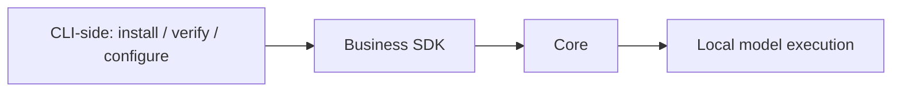

# Local inference

The Core executes ONNX models and, in an Apple Silicon build with the optional
`mlx` feature, BGE-M3 safetensors through Apple MLX. CLI-side code manages
downloads, checksums, progress and engine settings.

| Engine | Platform | Requirement |
| --- | --- | --- |
| CPU | Windows, Apple Silicon, Linux | Default |
| GPU | Windows, Apple Silicon | Explicit selection and compatible hardware/model |
| NPU | Windows, Apple Silicon | Explicit selection and compatible provider/hardware/model |

Choose an engine in the TUI or run `rsrs model engine cpu|gpu|npu`.
On the Models page, open **Choose engine and model weights** to draft CPU/GPU/NPU
and one of `quantized`, `fp16`, `int8`, `uint8`, `q4`, or `q4f16`.

- **Download selected weights (keep current model)** prefetches the selected
  variant and its dependencies after a size-labelled confirmation. Repeat to
  prefetch multiple variants. Downloading does not change configuration or the
  current session. Verified files are reused.
- **Validate and load selected weights** never downloads. It checks pinned sizes
  and SHA-256 identities for the selected BGE-M3 weights, tokenizer and required
  CPU container, then loads and runs real trial inference. Only success saves
  the selection and checks runtime read-back. Missing, corrupt or unsupported
  weights are rejected. A failure after replacement attempts to reload and trial
  the previous model; failure to recover is explicitly reported.
- Escape/Back discards the draft; both confirmations default to cancel. Once a
  load starts it cannot be cancelled, and RPC cancellation explicitly rejects
  the request instead of acknowledging a cancellation it cannot honor. Downloads
  remain cancellable. File
  presence in the picker is metadata only, with checksums verified on loading.

GPU/NPU require compatible OS, hardware and providers. A listed variant is not a
compatibility guarantee; trial inference must succeed. No node-placement or
performance guarantee is implied. The commands are
`rsrs model install --model VARIANT --for-engine cpu|gpu|npu` for prefetch and
`rsrs model load cpu|gpu|npu --model VARIANT` for validated loading.
`rsrs model engine cpu|gpu|npu --model VARIANT` remains a settings-only CLI command;
TUI engine changes use the validated load path.

`RSRS_ENGINE` overrides legacy `inference.json` selection. Library profile
snapshots use their explicit selected engine instead. Automatic selection is unsupported.
Missing hardware and inference failures are reported without switching engines.
Provider names do not prove execution of every operation on the requested device.

| Command | Purpose |
| --- | --- |
| `model install` / `model install-m3` | Install or verify pinned BGE-M3 quantized (543 MiB model plus tokenizer) |
| `model uninstall` / `model uninstall-m3` | Delete user-installed M3 files |
| `model activate m3` | Legacy M3 rebuild interface |
| `reembed` | Rebuild/resume the active library profile's index |
| `model install-engines` | Explicit Windows provider installation |
| `model probe --json` | Actual M3 inference diagnostics |
| `model reset-cpu` | Host-only CPU runtime recovery |
| `restart --timeout 10` | Graceful restart; terminate the verified runtime after the deadline |

BGE-M3 uses `onnx/model_quantized.onnx` from `Xenova/bge-m3` revision
`4de13258303883538bd53b696b452bf8099f0858`: 569694530 bytes, SHA-256
`0826f8c1ab9edf1801db86c61919d4d108e8bfc0b809ec823ad366882ff0b77d`.
The Apple MLX preset `m3-mlx` instead downloads
`mlx-community/bge-m3-mlx-fp16` at revision
`a37eddded9a6a1273a87fb8b0da0d1cdbd98aeec` (1135554209-byte safetensors plus its
tokenizer). Activate it with
`rsrs model switch m3-mlx --backend mlx --engine gpu`; the Core SDK must have
been built with the `mlx` feature on Apple Silicon. MLX uses its own index
generation and never falls back to ONNX silently.

The same SDK ships `runtime/mlx.metallib` next to the executable; MLX resolves a
colocated `mlx.metallib` before its build-time default path. A packaged host that
moves the executable must keep that file in the same directory, otherwise the MLX
Metal stream fails explicitly instead of falling back to ONNX or CPU.
The tokenizer remains pinned to the same revision and checksum. FP16 and
`model_int8.onnx` cannot substitute for this file. This model has its own index
generation; old vectors are rebuilt using resumable checkpoints and the completed
generation is activated atomically. Subsequent restarts reuse this generation.

Embedding profiles support arbitrary model IDs and explicit execution settings.
The presets are BGE-M3 (1024 dimensions) and `bge-small-zh-v1.5` (512 dimensions,
Chinese query prefix). Both use CLS pooling and L2 normalization. See
[embedding profiles](model-profiles.md) for catalog/configure/switch/progress.
The commands above remain the legacy M3 interface: `--model` on
`model engine/load/install` continues to mean an M3 weight variant.
The TUI download-source editor offers auto, hf-mirror.com, hf-mirror.net and the
official Hugging Face origin, plus a custom URL. `--mirror` overrides
`RSRS_MIRROR`, then the persisted `model_mirror` setting; default is auto. These
settings apply to the tokenizer and ONNX file. Auto tries hf-mirror.com,
hf-mirror.net, then huggingface.co; an explicit source fails without switching.

CPU execution additionally uses `model_quantized.cpu-v1.ort`, the exact CPU ORT
container from the [pinned release](https://github.com/risense-ai/respire-cli/releases/tag/model-bge-m3-ort-v1):
569654128 bytes, SHA-256
`7ff152e912bc234f5c90e4012f99897a7b2ce180f016db2321304057756b64ff`.
This is a separate artifact; a Hugging Face ONNX file cannot replace it. GPU/NPU
continues to use the pinned ONNX file. The CPU container preserves the quantized
weights and does not change vectors or the index schema.

CPU release downloads use a separate source setting: `RSRS_CPU_ORT_MIRROR`
overrides the persisted `model_cpu_ort_mirror` setting; default is `auto`.
The TUI Hugging Face source selector and `--mirror` do not override this setting.
For a saved choice, use `rsrs agent-config --set model_cpu_ort_mirror=github`
(or `auto` or a custom origin), then retry installation.
- `auto`: try `https://gh-proxy.org/` with the exact official GitHub release URL
  appended, then the official GitHub release URL.
- `github`: use the official GitHub release only.
- A custom HTTP(S) proxy origin, such as `https://mirror.example`: append the
  official GitHub release URL and use only that proxy. Credentials, additional
  paths, queries and fragments are rejected. A bare hostname uses HTTPS.

The default proxy is an independent third-party service. Only the public release
URL is sent to it; no account authorization headers are added. The exact file and
SHA-256 were verified through this proxy, including a nonzero Range response;
this does not guarantee availability from every region or network. No npm copy
or unverified Hugging Face CPU artifact is assumed.

Both artifact families share bounded TCP connection (10 seconds), idle read
(30 seconds, including response headers) and write (10 seconds) waits. A stalled
or failed auto source advances to the next source; there is no overall download
time limit that interrupts a still-progressing large file. System DNS resolution
follows the platform resolver's own timeout. Cancellation and local
disk errors stop the operation rather than trying another mirror. Source failures
release the active download slot so installation can be retried.

All sources retain the pinned revision, file size and SHA-256 checks. Files are
staged before replacement; cancellation and source changes preserve partial files
for resume. Servers that ignore Range restart the file safely. A corrupt resumed
prefix or invalid parallel segments are discarded and retried from byte zero;
unused segment files are removed after successful fallback. A fully downloaded checksum
failure is rejected before fallback. CPU source provenance is recorded alongside
the verified cache artifact.
`RSRS_M3_DIR` overrides `~/.rsrs/models/bge-m3`. Old BGE directories and
`RSRS_MODEL_DIR` are not used. Model weights and engine selection are global;
legacy settings do not select another model directory. Profile selections,
in contrast, belong to each library and follow account/library switching.

The resident host supervises a dedicated Core worker that reuses foreground and
background native sessions. Worker IPC uses private inherited anonymous
stdin/stdout pipes; it opens no network listener or SQLite database. The local
HTTP RPC interface uses TCP loopback, without named-pipe or Unix-socket listeners.
Transport credentials, library ownership and SQLite commits remain in the host;
health and progress requests remain independent of native execution.

Native admission uses a FIFO queue with at most 32 waiting requests and a
120-second queue wait. A full queue rejects admission; an expired waiter is
removed before native execution. Native model loading and inference each retain
the SDK's 120-second deadline. Deadline expiry requests cooperative native
cancellation and rejects late results; providers may still fail to release a
stuck native call.

If a cancelled native call stays unresponsive for another five seconds, worker
heartbeats stop for ten seconds, or a complete Core call exceeds 365 seconds,
the supervisor fails pending calls without replay and terminates the owned child.
It must confirm exit before starting a replacement; later requests reload their
authorized resident view and model. If termination cannot be confirmed,
replacement is prohibited and host recovery is required. `rsrs restart --timeout
10` requests graceful host shutdown and terminates its verified process when the
deadline expires. See [worker recovery](retrieval.md) for the boundaries of
in-flight host callbacks and committed writes.

Native errors retain their underlying cause and do not switch engines or
permanently disable an engine after one failed call. Recovery does not delete
models or memories. Sandboxes cannot take over runtime lifecycle. Models retain
upstream cards, licenses and source information;
SDK runtime bundles carry native and model notices. ONNX Runtime's license does not
replace model-weight licenses. See [notice sources](model-notices/sources.json).

| Validation | Limit |
| --- | --- |
| Local SDK | Windows x64 checked |
| Other targets | Require native SDK validation and pinned artifacts |
| Hosted CPU workflow | Existing check, not proof of local cross-platform completion |
| GPU/NPU workflow | Manual real-hardware validation; no blanket vendor support claim |
